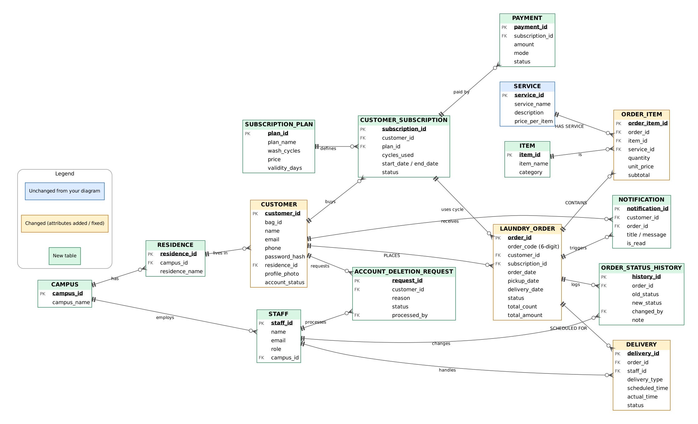

# HydraWash

> **Smart Campus & Hostel Laundry Management System**  
> A relational, 3NF-compliant laundry operations platform featuring an automated order lifecycle, live garment tracking, basket-style booking, and staff management workflows.

---

## 📌 Project Overview

**HydraWash** automates laundry operations for campus and hostel life. It replaces manual paper-based logs with a centralized digital platform where students can drop off clothes at their designated Laundry Counter, configure basket-style wash/dry/iron orders, monitor real-time machine telemetry and turnaround statuses, and receive instant pickup notifications.

A single, secure **Node.js + Express REST API** connects to **MySQL 8.0+** to serve both the web dashboard and mobile application clients.

---

## ✨ Features

- **Basket-Style Order Placement**: Multi-item laundry orders supporting custom fabric care plans (Wash & Fold, Tumble Dry, Steam Press, Delicate Wash).
- **Relational 3NF Schema & Integrity**: 15 normalized tables, foreign key constraints, composite primary keys, triggers, stored procedures, and audit logs.
- **Live Lifecycle Tracking**: Fine-grained progression through `Placed` → `Washing` → `Drying` → `Ironing` → `Packed` → `Counter Ready` → `Delivered`.
- **Logistics & Delivery Coordination**: Event-driven tracking of counter drop-offs, internal facility transfers, and student collection times.
- **Role-Based Access Control (RBAC)**: Secure JWT authentication separating students, laundry desk operators, and administrators.
- **Complaint & Resolution Desk**: Direct ticket logging for wash quality concerns, garment tracking inquiries, or turnaround delays.
- **Audit Trails & Automated History**: Trigger-driven `order_status_history` logging every stage transition with timestamps and operator IDs.
- **3D Agentic Machine Visualizer**: Interactive real-time 3D canvas rendering laundry equipment and telemetry.

---

## 🛠️ Tech Stack

| Layer | Technologies |
|---|---|
| **Backend API** | Node.js, Express.js (Modular Router Architecture, JWT, Async Handler) |
| **Database** | MySQL 8.0+ / MariaDB (InnoDB, Transactions, Stored Procedures, Triggers, Views) |
| **Frontend Web** | React 19, Vite, Tailwind CSS, Motion, Three.js / Agentic 3D |
| **Deployment** | Vercel (Fullstack Monorepo: Edge Static Frontend + Serverless API) |
| **Mobile App** | React Native *(Planned)* |
| **Tooling & Docs** | MySQL Workbench (Reverse Engineering), Markdown, Draw.io / Mermaid |

---

## 📊 Relational Database Architecture

The HydraWash schema enforces strict 3NF database normalization, using views to compute dynamic order totals and triggers to maintain status history.



---

## 🚀 Vercel Deployment

This repository is configured as a fullstack monorepo ready for immediate deployment on **Vercel**:

- **Frontend Build**: Vite compiles `frontend/` to `frontend/dist`.
- **Serverless API**: `api/index.js` bridges all `/api/*` routes into the Express backend.
- **Configuration**: Managed seamlessly via `vercel.json` without requiring separate hosting services.

### Environment Variables on Vercel
Add the following in your Vercel Project Settings (`Settings -> Environment Variables`):
```env
DB_HOST=<your-mysql-host>
DB_PORT=3306
DB_USER=<your-mysql-user>
DB_PASSWORD=<your-mysql-password>
DB_NAME=<your-mysql-database>
JWT_SECRET=<your-secure-jwt-secret>
```

---

## 📚 Project Documentation & Quick Links

| Resource | Description | Path |
|---|---|---|
| **Backend Setup & API Guide** | Step-by-step setup, MySQL linking, and REST endpoints | [`backend/README.md`](backend/README.md) |
| **Frontend Setup & Components** | UI setup, design system, and modal interactions | [`frontend/README.md`](frontend/README.md) |
| **Project Report** | Full ER diagram specifications and design documentation | [`docs/report/`](docs/report/) |
| **Presentation Decks** | Project pitch and system architecture slides | [`docs/presentation/`](docs/presentation/) |
| **ER Diagram Assets** | High-resolution PNG and vector SVG diagram exports | [`docs/er-diagrams/`](docs/er-diagrams/) |
| **Media & Screenshots** | Application screenshots, brand assets, and badges | [`docs/screenshots/`](docs/screenshots/) |
| **Reference Material** | Development changelog and token references | [`docs/reference/`](docs/reference/) |

---

## 🗺️ Roadmap

- [x] **Relational Database Design**: 3NF schema, indexes, views, triggers, and seed data.
- [x] **Backend REST API**: Complete authentication, basket orders, tracking, staff admin, and complaints endpoints.
- [x] **Frontend Web Application**: Interactive React + Tailwind CSS client with 3D factory visualization and 5 interactive modals.
- [x] **Vercel Fullstack Deployment**: Configured monorepo with serverless API bridging and SPA fallback.
- [ ] **Mobile Application**: Native mobile app for iOS and Android *(Coming Soon)*.

---

## 📄 License

This project is licensed under the MIT License - see the [`LICENSE`](LICENSE) file for details.
